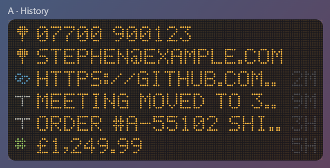
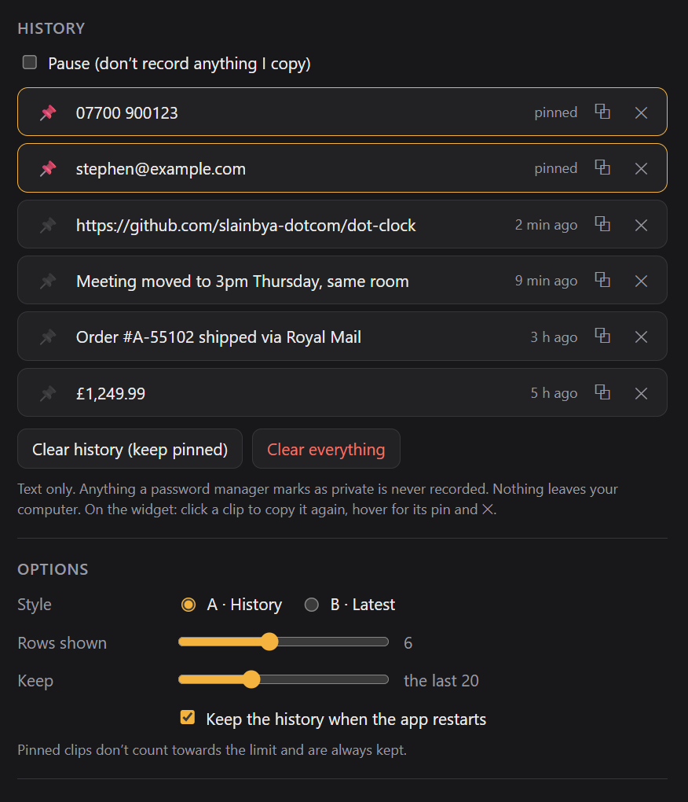

# Dot Clipboard

A dot-matrix clipboard history for Windows and macOS. It remembers the last things you copied, so you can click to copy them again.

## What it does

**Two styles.** Pick one in settings:

| Style | What it looks like |
|---|---|
| A · History | Your recent copies, newest first, with pinned ones always on top. A small symbol shows what each is (text, link, number, several lines), with its age on the right |
| B · Latest | One line with your latest copy scrolling across. Use ◂ ▸ (or the mouse wheel) to step back, and dots show where you are |

- **Copy it again:** click any clip and "COPIED" flashes green.
- **Pin and remove:** hover over a clip in History for its 📌 pin and ✕. Pinned clips are always kept and don't count towards the limit.
- **Scroll:** scroll the mouse wheel when there are more clips than rows.
- **Settings:**
  - see the full history, pin, copy or remove clips
  - **Clear history** (keeps pinned) or **Clear everything**
  - how many to keep (5–50) and how many rows to show
  - whether to keep the history when the app restarts

## Privacy

- **Text only.** Images and files are ignored.
- **Private copies are skipped.** Anything a password manager marks as private is never recorded. That includes 1Password, Bitwarden, KeePass and others that use the standard Windows or macOS "don't record this" markers.
- **Pause** from the widget, settings or the tray menu, and nothing you copy is recorded. Things copied while paused aren't picked up afterwards.
- **Stays on your computer.** The history is saved in the app's settings file. Turn off "Keep the history when the app restarts" if you'd rather it started fresh each time.

## Where it lives

The widget doesn't take up a spot on the taskbar (or the Dock on a Mac). It sits in the **system tray** (the menu bar on a Mac) instead. Left-click the tray icon to bring the widget forward, and right-click it to show or hide the widget, pause or resume, open settings, move the widget to the centre of the screen, or quit.

## Building it yourself

See [BUILDING.md](BUILDING.md). The installer is called `Dot Clipboard_1.0.0_x64_en-US.msi`.

## Check out the Singular Widgets

[Dot Calendar](https://github.com/slainbya-dotcom/dot-Calendar)
[Dot Clipboard](https://github.com/slainbya-dotcom/dot-clipboard)
[Dot Clock](https://github.com/slainbya-dotcom/dot-clock)
[Dot Deck](https://github.com/slainbya-dotcom/dot-deck)
[Dot Dice](https://github.com/slainbya-dotcom/dot-dice)
[Dot Focus](https://github.com/slainbya-dotcom/dot-focus)
[Dot Launcher](https://github.com/slainbya-dotcom/dot-launcher)
[Dot List](https://github.com/slainbya-dotcom/dot-list)
[Dot Planner](https://github.com/slainbya-dotcom/dot-planner)
[Dot Player](https://github.com/slainbya-dotcom/dot-player)
[Dot Reader](https://github.com/slainbya-dotcom/dot-reader)
[Dot Sun](https://github.com/slainbya-dotcom/dot-sun)
[Dot System](https://github.com/slainbya-dotcom/dot-system)
[Dot Ticker](https://github.com/slainbya-dotcom/dot-ticker)
[Dot Timer](https://github.com/slainbya-dotcom/dot-timer)
[Dot Visualiser](https://github.com/slainbya-dotcom/dot-visualiser)
[Dot Weather](https://github.com/slainbya-dotcom/dot-weather)